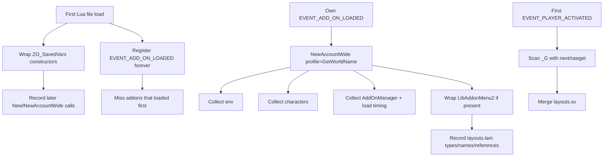

# Architecture

MacMinion companion: observe the running game, write a small snapshot to `EsoMacMinion_Data`.

## Manifest load order

1. `src/Core.lua` — namespace, SafeCall, logging, schema helpers
2. `src/hooks/SavedVars.lua` — wrap `ZO_SavedVars` constructors at file scope
3. `src/hooks/AddonObserver.lua` — `EVENT_ADD_ON_LOADED` for every later addon (never unregistered)
4. `src/hooks/LAM.lua` — wrap `LibAddonMenu2` if it is already loaded
5. `src/record/Layout.lua` — constructor / LAM bookkeeping (types and names only)
6. `src/record/Scan.lua` — `_G` backfill at first `EVENT_PLAYER_ACTIVATED`
7. `src/collect/Env.lua` — game / client
8. `src/collect/Characters.lua` — roster
9. `src/collect/Addons.lua` — AddOnManager + load timing
10. `src/settings/Defaults.lua` — defaults, reset, clear
11. `src/settings/Initializer.lua` — per-character bucket helpers
12. `src/Commands.lua` — `/emm`
13. `src/settings/SupportFooter.lua` — Buy Me a Coffee + in-game gold
14. `src/settings/Panel.lua` — LibAddonMenu panel
15. `src/Init.lua` — own SavedVars (`profile = GetWorldName()`), collectors (must be last)

## Runtime flow

## Namespace

| Token | Value | Meaning |
|---|---|---|
| Global | `EsoMacMinion` | ESO folder / manifest basename |
| Alias | `EMM` | Short Lua alias |
| SavedVariables | `EsoMacMinion_Data` | Account-wide snapshot table |
| Slash | `/emm` | Primary command |

## Adding modules

- Place new Lua under `src/` (or `src/<area>/`)
- Append paths to `EsoMacMinion.txt` **before** `src/Init.lua`
- Keep Init thin: register events and wire modules; put logic in named modules
